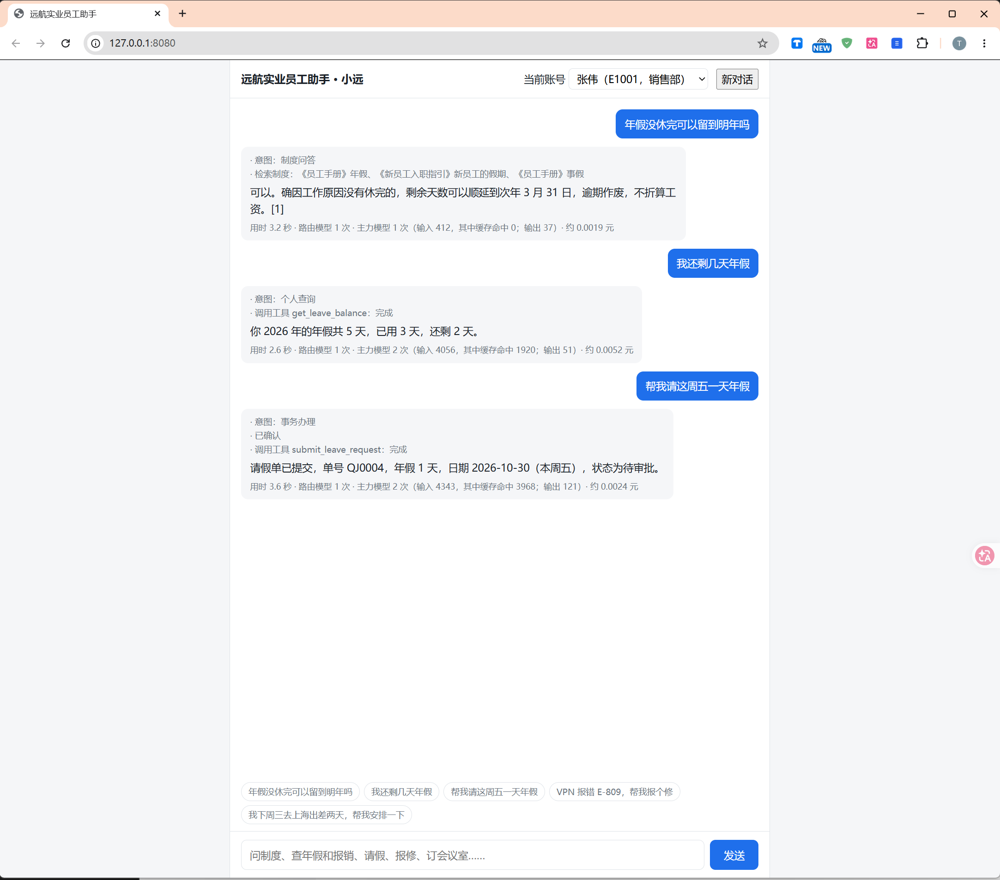
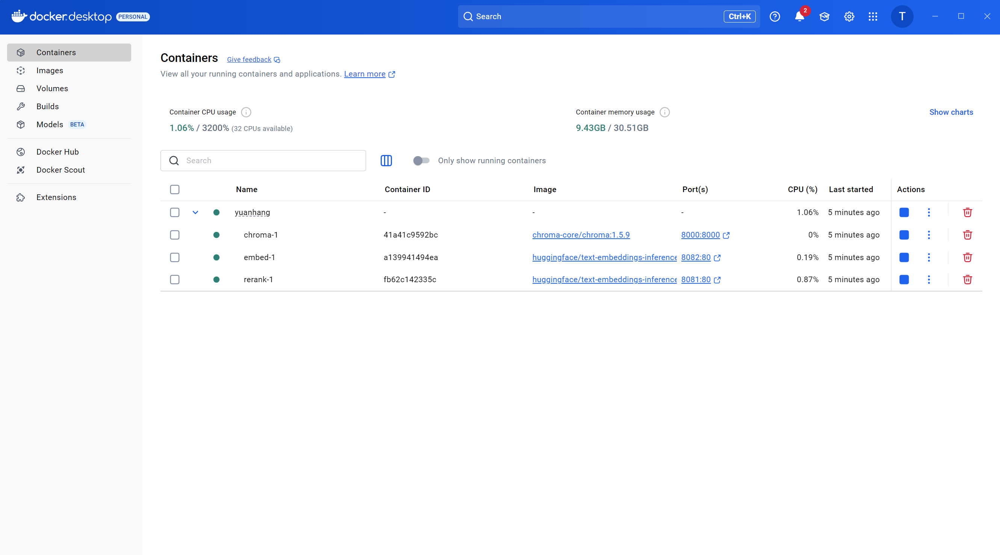

# 远航实业员工助手

《Agent 开发指南》第 13 章的实战项目。员工在网页上提问，助手“小远”可以解答公司制度、查询本人的年假和报销进度、办理请假和报修，并能处理“安排一次出差”这样的多步请求。

## 需要准备的东西

| 组件 | 用途 | 说明 |
| --- | --- | --- |
| Python 3.12 | 运行应用 | |
| Docker | Chroma、Embedding 服务、重排序服务 | 三个容器，见 `docker-compose.yml` |
| DeepSeek 的密钥 | 回答、工具调用、规划 | 环境变量 `DEEPSEEK_API_KEY` |
| 两个模型的文件 | Embedding 和重排序 | `BAAI/bge-small-zh-v1.5`、`BAAI/bge-reranker-base` |

模型文件用项目自带的脚本下载（见下面“启动”的第 2 步）。它默认从 Hugging Face 的国内镜像站 <https://hf-mirror.com> 下载，保存到 `D:/work/model`（可以用环境变量 `MODEL_DIR` 修改）。下载完成之后的目录结构如下：

```text
MODEL_DIR/
├── bge-small-zh-v1.5/      model.safetensors、config.json、tokenizer.json、tokenizer_config.json、
│                           special_tokens_map.json、vocab.txt、modules.json、
│                           config_sentence_transformers.json、sentence_bert_config.json、
│                           1_Pooling/config.json
└── bge-reranker-base/      onnx/model.onnx、config.json、tokenizer.json、tokenizer_config.json、
                            special_tokens_map.json、sentencepiece.bpe.model
```

想手动下载的话，在镜像站上打开 [BAAI/bge-small-zh-v1.5](https://hf-mirror.com/BAAI/bge-small-zh-v1.5) 和 [BAAI/bge-reranker-base](https://hf-mirror.com/BAAI/bge-reranker-base)，只下载上面列出的文件。两个仓库里的 `pytorch_model.bin`，以及重排序模型的 `model.safetensors`，都不需要下载，原因见 [架构文档.md](架构文档.md) 的 5.1 节。

## 启动

以下命令都在 `project` 目录下执行。

```bash
# 1. 创建虚拟环境并安装依赖
python -m venv .venv
.venv\Scripts\activate            # Linux / macOS：source .venv/bin/activate
pip install -r requirements.txt

# 2. 下载两个模型的文件（约 1.2 GB，支持断点续传）
python -m scripts.download_models

# 3. 启动三个基础服务
docker compose up -d

# 4. 知识库入库（清洗、分块、向量化，写入 Chroma）
python -m scripts.index_knowledge

# 5. 启动应用
uvicorn app.api:app --port 8080
```

国内的网络环境下，模型文件和 Docker 镜像都默认从镜像站获取，不需要访问 huggingface.co 和 ghcr.io：

| 内容 | 默认的来源 | 换回官方地址 |
| --- | --- | --- |
| 模型文件 | `https://hf-mirror.com` | 环境变量 `HF_ENDPOINT=https://huggingface.co` |
| Docker 镜像 | `ghcr.nju.edu.cn` | 环境变量 `IMAGE_REGISTRY=ghcr.io` |

打开 <http://127.0.0.1:8080>，在右上角选择一个员工账号就可以提问。业务数据库在第一次启动时自动创建。

全部数据（向量库、业务数据、对话的检查点、轨迹）保存在 `runtime` 目录下，重启应用、Docker 或者机器之后都还在。想把演示数据恢复到初始状态，停掉应用后运行 `python -m scripts.reset_data`；不要直接删除 `runtime` 目录，那样会连向量库一起删掉。

不想开网页时，可以在命令行里对话，它会显示经过的节点、工具调用和用量：

```bash
python -m scripts.chat E1001
```

## 配置

全部配置在 `app/config.py`，都可以用环境变量覆盖。常用的几项：

| 环境变量 | 默认值 | 含义 |
| --- | --- | --- |
| `DEEPSEEK_API_KEY` | 无 | 模型的密钥 |
| `WORKER_BASE_URL`、`WORKER_MODEL` | DeepSeek 的地址、`deepseek-chat` | 主力模型：改写、生成、工具调用、规划 |
| `ROUTER_BASE_URL`、`ROUTER_MODEL`、`ROUTER_API_KEY` | 与主力模型相同 | 路由模型：意图识别和闲聊的回复。可以单独换成更小的模型 |
| `WORKER_PRICE_INPUT`、`WORKER_PRICE_CACHED`、`WORKER_PRICE_OUTPUT` | 2、0.04、8 | 主力模型的单价（元 / 百万词元）：缓存未命中的输入、缓存命中的输入、输出。默认值是 `deepseek-flash` 2026 年 10 月的高峰时段价格，空闲时段是它的一半 |
| `ROUTER_PRICE_INPUT`、`ROUTER_PRICE_CACHED`、`ROUTER_PRICE_OUTPUT` | 与主力模型相同 | 路由模型的单价 |
| `YUANHANG_TODAY` | 系统日期 | 把“今天”固定为某一天，例如 `2026-10-12` |
| `LANGSMITH_TRACING`、`LANGSMITH_API_KEY` | 无 | 两项都设置之后，每次请求会上报到 LangSmith |

两个角色默认是同一个模型。想给意图识别单独换一个模型时，设置 `ROUTER_BASE_URL`、`ROUTER_MODEL`、`ROUTER_API_KEY` 和三个 `ROUTER_PRICE_*` 即可。路由模型连接不上或者超时的时候，应用会自动改由主力模型识别意图。

架构、调用链、生产环境的改造建议和完整的使用手册见 [架构文档.md](架构文档.md)。

## 目录

```text
project/
├── docker-compose.yml        Chroma、Embedding、重排序三个服务
├── data/knowledge/           五份制度文档
├── app/
│   ├── config.py             配置
│   ├── db.py                 业务数据层：按工号隔离，业务规则
│   ├── rag/ingest.py         清洗、分块
│   ├── rag/retriever.py      向量检索、BM25、RRF、重排序
│   ├── mcp_servers/          人事、IT 两个 MCP 服务器
│   ├── tools.py              工具层：合并本地工具和 MCP 工具，绑定工号
│   ├── llm.py                两个模型角色，并发、超时、用量
│   ├── prompts.py            全部提示词
│   ├── graph.py              LangGraph 图
│   ├── service.py            驱动图运行，产生事件，写轨迹
│   ├── observability.py      轨迹与指标
│   ├── api.py                FastAPI 接口
│   └── static/index.html     页面
├── scripts/                  入库、命令行对话、接口冒烟检查
├── eval/                     数据集、评估脚本、报告
└── tests/                    不需要模型和 Docker 的测试
```

## 测试与评估

```bash
# 测试：模型用脚本化的替身，不需要密钥和 Docker，半分钟之内完成
pytest tests -q

# 检索评估：比较四种检索方式（需要 Docker 服务，不调用大模型）
python -m eval.run_retrieval

# 意图识别评估：准确率、耗时、费用（比较另一个模型的办法见脚本开头的说明）
python -m eval.run_intent

# 端到端评估：保存为基线，修改之后再与基线比较
python -m eval.run_e2e --label baseline
python -m eval.run_e2e --label v2 --compare baseline

# 可靠性：写入类和复合任务的样本重复 3 次
python -m eval.run_e2e --label passk --repeat 3

# 忠实度：先校准评判模型，再评判制度问答的回答
python -m eval.run_faithfulness baseline
```

评估使用独立的数据目录（`runtime/eval`），并把“今天”固定为 2026-10-12，不会影响正在运行的应用。

## 运行时的接口

| 接口 | 作用 |
| --- | --- |
| `POST /api/chat` | 发送一条消息，以 SSE 返回事件 |
| `POST /api/confirm` | 对等待确认的操作表示同意或拒绝 |
| `GET /api/metrics` | 汇总的监控指标 |
| `GET /api/traces` | 最近的若干条轨迹 |

每个请求的轨迹追加在 `runtime/traces.jsonl` 中，一行一条。

## 已知的简化

- 登录只是在请求头里带一个工号，没有真正的身份认证。
- 写入操作只到“提交申请”为止，没有审批流。
- 员工的数据会进入接口模型的上下文。演示数据是虚构的；用于真实的数据之前，需要评估数据合规，或者把接口模型换成私有部署的模型。

## 系统截图


